# wapt-webconsole


Console web pour serveur [WAPT](https://www.wapt.fr) **Discovery** : inventaire des machines, actions à distance, affectation de paquets et de groupes, gestion du dépôt, import depuis le store Tranquil IT. Elle remplace `waptconsole.exe` au quotidien, depuis un navigateur sur ordinateur, tablette ou téléphone Android.

**[Documentation](docs/README.md)** · **[Changelog](CHANGELOG.md)** · **[Feuille de route](ROADMAP.md)** · Licence [GPL-3.0-or-later](LICENSE), comme WAPT

> Projet en cours de développement, dépôt privé.

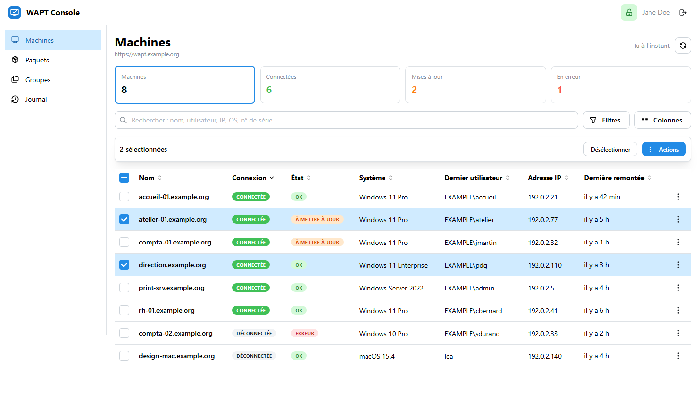

## Ce que fait la console

| Fonction | Ce qu'elle permet | Rôle requis |
|---|---|---|
| **Machines** | Inventaire en direct, indicateurs servant de filtres (connectées, mises à jour, erreurs), 25 colonnes à choisir et trier, recherche, filtres par système, état, audit, domaine ou agent | lecture |
| **Fiche machine** | Système, matériel et disques, réseau, utilisateurs, paquets avec journaux d'installation et d'audit, logiciels, paquet machine | lecture |
| **Actions à distance** | Mettre à jour l'index, appliquer les mises à jour, installer, lancer l'audit, annuler, Wake-on-LAN ; sur une machine ou une sélection, par clic droit, appui long ou bouton `⋮` | opérateur |
| | Désinstaller, oublier un paquet, changer la description, redémarrer l'agent, redémarrer ou éteindre la machine | admin |
| **Tâches** | Tâches de l'agent en cours, en attente, en erreur et terminées, avec leurs journaux, actualisées toutes les 3 secondes | opérateur |
| **Affectation** | Ajouter ou retirer des paquets et des groupes sur des machines : aperçu avant/après, signature, publication, mise à jour immédiate en option | admin |
| **Paquets et groupes** | Dépôt avec icônes et état de déploiement ; créer, modifier, supprimer des groupes ; envoyer un `.wapt` signé ; supprimer un paquet ; nettoyer les versions remplacées | lecture / admin |
| **Store** | Catalogue Tranquil IT filtré pour vos systèmes, mises à jour disponibles pour le dépôt, import en arrière-plan (signature d'origine vérifiée, renommage à votre préfixe, signature avec votre clé, dépendances incluses) | lecture / admin |
| **Journal** | Qui a fait quoi, sur quelles machines, avec quel certificat et quel résultat | opérateur |

Les actions qui modifient le parc sont **signées avec la clé de l'opérateur**, comme dans la console WAPT : les agents refusent toute action ou tout paquet non signé par un certificat de confiance.

## Aperçu

| | |
|---|---|
| 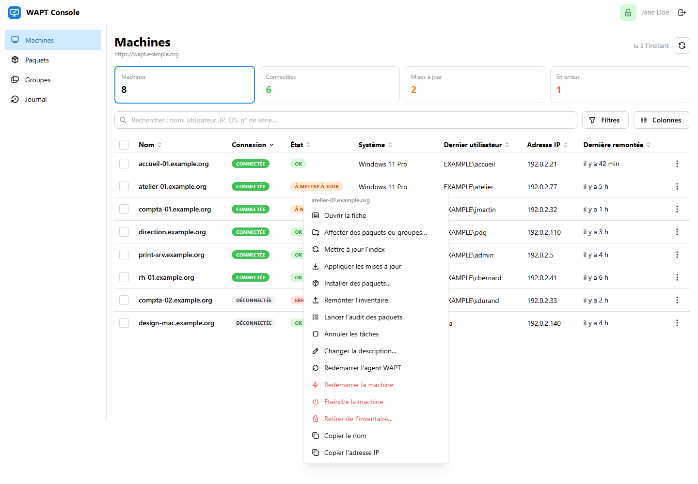 | 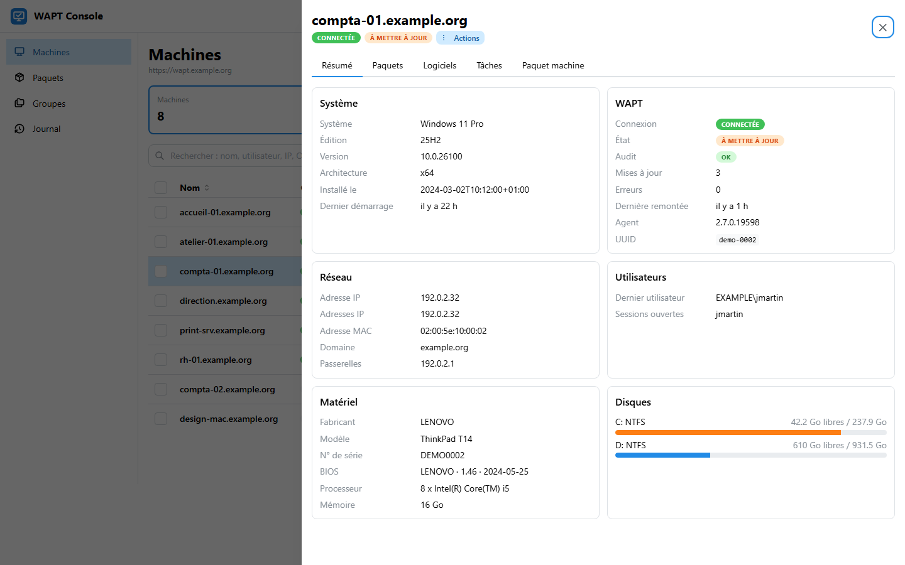 |
| **Clic droit, appui long ou `⋮`** : un seul menu d'actions, selon le rôle et l'état de la machine | **Fiche machine** : panneau latéral avec son adresse propre |
| 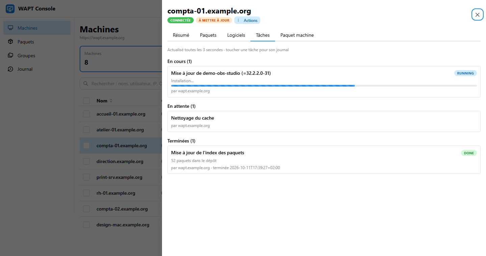 | 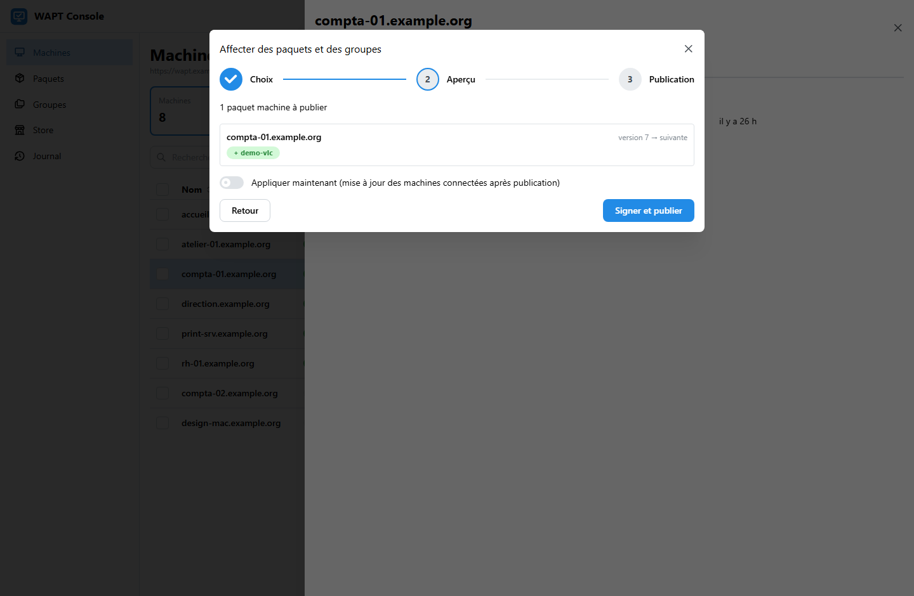 |
| **Tâches** : progression et journaux de l'agent | **Affectation** : aperçu du paquet machine avant signature et publication |
| 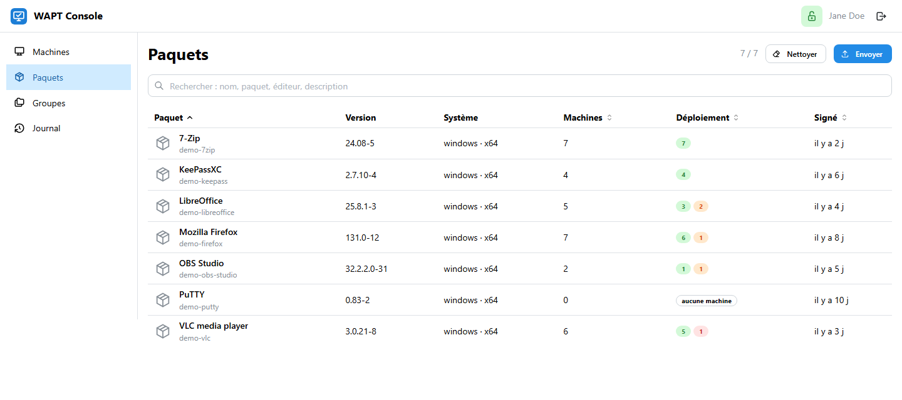 | 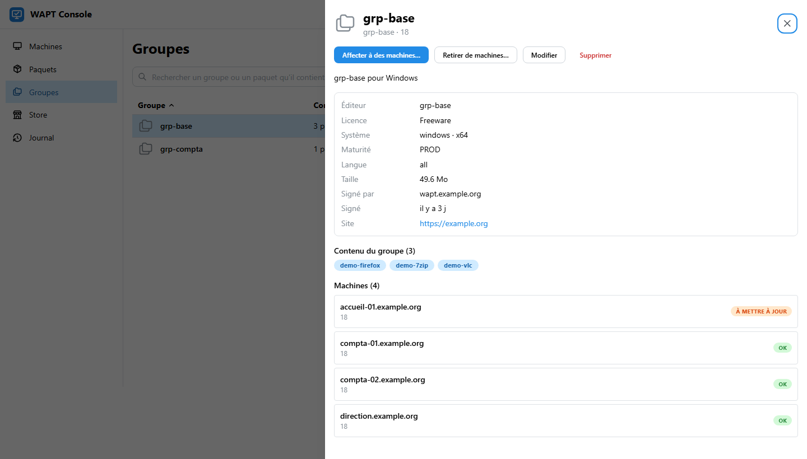 |
| **Paquets** : dépôt, déploiement par paquet (installé, en attente, en erreur) | **Groupes** : contenu, machines, modification |
| 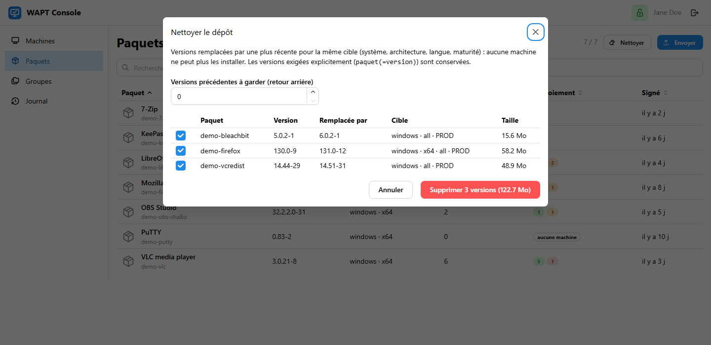 | 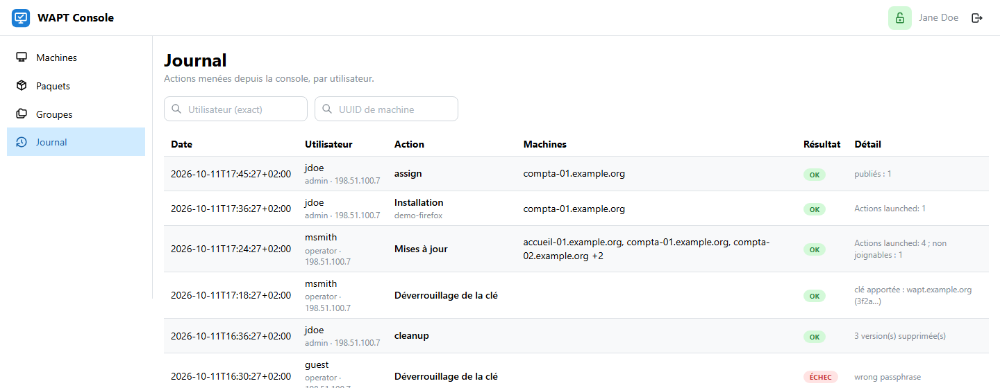 |
| **Nettoyage du dépôt** : versions qu'aucune machine ne peut plus installer | **Journal** : chaque action, son auteur et son signataire |
| 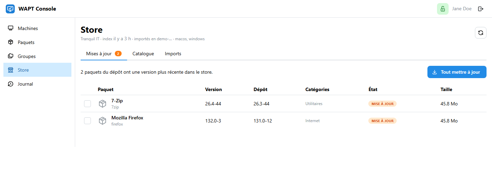 | 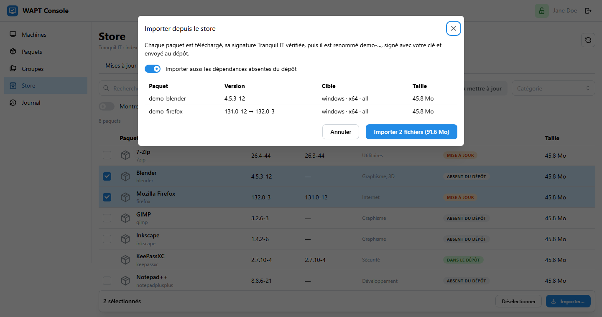 |
| **Store** : versions plus récentes que celles du dépôt, mise à jour en un clic | **Import** : plan avec dépendances et tailles, puis suivi paquet par paquet |
| 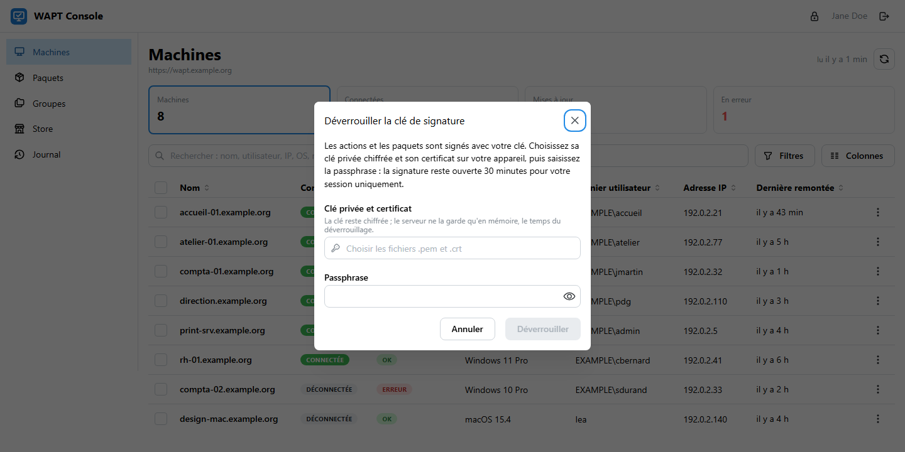 | |
| **Clé de signature** : apportée depuis l'appareil, gardée en mémoire 30 minutes | |

Sur téléphone : cartes au lieu du tableau, fiche en plein écran, menu d'actions en feuille du bas.

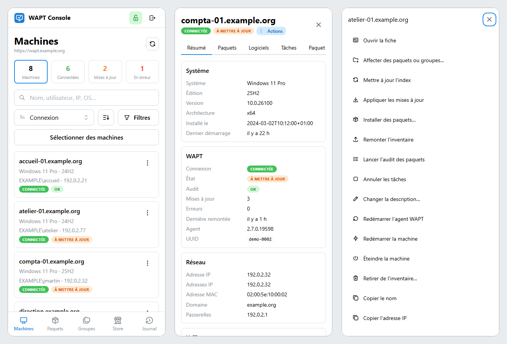

Les captures sont faites sur des données fictives (`scripts/demo_server.py`), régénérables avec `scripts/screenshots.py`.

## Sécurité

- **Connexion par SSO** (OpenID Connect, par exemple Authelia), double authentification exigée par le fournisseur. Rôles lecture, opérateur et admin déduits de ses groupes (`wapt-viewers`, `wapt-operators`, `wapt-admins`).
- **Aucune clé de signature sur le serveur** : chaque opérateur choisit sa clé privée chiffrée et son certificat sur son appareil et saisit la passphrase. Le serveur garde la clé en mémoire dans un processus propre à la session, 30 minutes au plus, jamais sur disque. Les signatures sont produites par `waptpython`, l'implémentation de référence de WAPT.
- **Rien n'est écrasé à l'aveugle** : la version d'un paquet machine ou d'un groupe est relue avant publication, une modification faite entre-temps dans la console WAPT est signalée.
- **Confirmations** : toujours pour les actions destructrices, nombre de machines à retaper dès 10 machines.
- **Journal d'audit** : en Discovery, le serveur WAPT ne connaît que le compte `admin` ; la console enregistre l'utilisateur, son IP, les machines, le certificat signataire et le résultat.
- Session signée (`HttpOnly`, `Secure`, `SameSite=Lax`), jeton CSRF, CSP stricte, conteneurs en lecture seule, sans privilèges et non root.

## Architecture

```
navigateur ──HTTPS──▶ reverse proxy ──▶ frontend (nginx, React + Mantine) ──▶ backend (FastAPI) ──▶ serveur WAPT
                                                                                 │  └─ waptpython : signer.py
                                                                                 └─ /data : journal (SQLite)
```

Le backend est le seul à interroger le serveur WAPT : un cache de 15 secondes pour l'inventaire, un WebSocket pour l'état en direct, une seule boucle de lecture quel que soit le nombre de navigateurs.

## Démarrage rapide

Il faut Docker avec Compose, un fournisseur OpenID Connect et un serveur WAPT 2.7 Discovery joignable par son URL publique.

```bash
git clone https://git.k3nny.fr/k3nny/wapt-webconsole && cd wapt-webconsole/deploy
cp .env.example .env              # WWC_PUBLIC_URL, WWC_WAPT_URL, WWC_OIDC_ISSUER...
./init-secrets.sh                 # secret de session, mot de passe admin WAPT, secret OIDC
docker compose up -d --build
```

Puis déclarer la console dans le fournisseur OIDC (Authelia : `deploy/authelia-register.sh`) et publier le frontend derrière le reverse proxy. Le détail est dans [le guide de déploiement](docs/deploy.md).

## Développement

```bash
cd backend && uv sync && uv run pytest && uv run ruff check src tests    # 54 tests
cd frontend && npm ci && npm run dev                                     # interface sur :8080, API sur :8000
python3 scripts/demo_server.py                                           # interface sur données fictives, sans serveur
python3 scripts/screenshots.py                                           # captures de docs/images
```

## Documentation

- [Déploiement](docs/deploy.md) : Docker Compose, secrets, Authelia, reverse proxies, clé de signature
- [API du serveur WAPT 2.7](docs/wapt-api.md) : endpoints et actions utilisés, établis à partir des sources du serveur
- [Prototype de signature](docs/prototype-signature.md) : validation de la chaîne de signature sur un agent réel
- [Plan](PLAN.md) et [feuille de route](ROADMAP.md)

## Limites

- **WAPT Discovery** : les fonctions Enterprise (unités, profils, self-service, WAPTWUA, WADS, ACL) ne sont pas couvertes.
- Les actions ne touchent que les machines **connectées** au serveur WAPT ; les autres sont signalées, et peuvent être réveillées par Wake-on-LAN.
- La clé de signature transite jusqu'au serveur de la console le temps du déverrouillage ; la signature entièrement dans le navigateur est à l'étude ([feuille de route](ROADMAP.md)).
- Store : seul le certificat Tranquil IT (empreinte configurée) est accepté ; les paquets réservés à WAPT Enterprise et ceux liés à la version du serveur (`waptupgrade`, `waptagent`…) ne sont pas importés.
